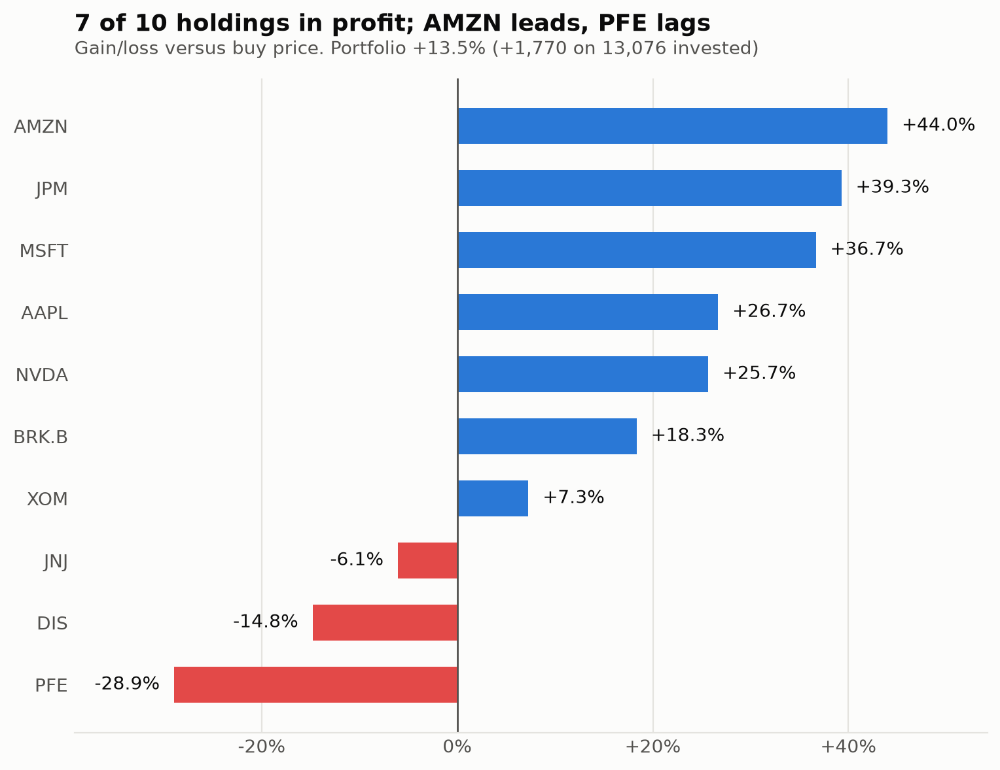
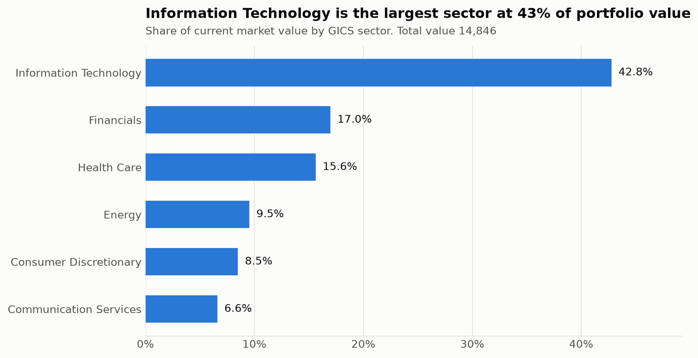

# Stock Portfolio Performance Tracker

A command-line tool for tracking stock portfolio valuation, calculating unrealized profit/loss, monitoring sector allocation, and recording historical portfolio snapshots.



## Features

- **Portfolio Valuation**: Calculates market value, gain/loss ($ and %), and portfolio weight for each holding.
- **Reference Data Enrichment**: Validates tickers against an S&P 500 company list to populate company names and GICS sectors.
- **Flexible Pricing**: Uses prices from a local CSV file, live quotes via `yfinance`, or manual entry fallback.
- **Lot Merging**: Combines multiple purchases of the same stock into a single holding with a weighted-average cost basis.
- **Sector & Concentration Analysis**: Groups holdings by sector and warns if any position exceeds a concentration threshold (default 40%).
- **History Tracking**: Appends each evaluation to `outputs/portfolio_log.csv` and supports comparing past valuations with `--history`.
- **Visualizations**: Generates performance and sector allocation charts with `--charts`.

## Setup

The core tool uses the Python standard library. To enable charts and live price lookups:

```bash
pip install -r requirements.txt
```

## Usage

### Run with sample data
```bash
python portfolio_tracker.py --file data/holdings_sample.csv --prices data/prices_sample.csv
```

### Generate charts
```bash
python portfolio_tracker.py --file data/holdings_sample.csv --prices data/prices_sample.csv --charts
```

### Interactive mode
```bash
python portfolio_tracker.py
```

### View past runs
```bash
python portfolio_tracker.py --history
```

## Sample Output

```text
-----------------------------------------------------------------------------------------------------------------------
Ticker Company                       Shares       Buy       Now         Cost        Value       P/L $    P/L %   Weight
-----------------------------------------------------------------------------------------------------------------------
AAPL   Apple Inc.                        10    150.00    190.00     1,500.00     1,900.00     +400.00  +26.67%    12.8%
MSFT   Microsoft                          5    300.00    410.00     1,500.00     2,050.00     +550.00  +36.67%    13.8%
NVDA   Nvidia                            20     95.50    120.00     1,910.00     2,400.00     +490.00  +25.65%    16.2%
AMZN   Amazon                             7    125.00    180.00       875.00     1,260.00     +385.00  +44.00%     8.5%
JPM    JPMorgan Chase                     6    140.00    195.00       840.00     1,170.00     +330.00  +39.29%     7.9%
BRK.B  Berkshire Hathaway                 3    380.25    450.00     1,140.75     1,350.00     +209.25  +18.34%     9.1%
JNJ    Johnson & Johnson                  8    165.00    155.00     1,320.00     1,240.00      -80.00   -6.06%     8.4%
XOM    ExxonMobil                        12    110.00    118.00     1,320.00     1,416.00      +96.00   +7.27%     9.5%
DIS    Walt Disney Company (The)         10    115.00     98.00     1,150.00       980.00     -170.00  -14.78%     6.6%
PFE    Pfizer                            40     38.00     27.00     1,520.00     1,080.00     -440.00  -28.95%     7.3%
-----------------------------------------------------------------------------------------------------------------------
TOTAL                                                              13,075.75    14,846.00   +1,770.25  +13.54%   100.0%
-----------------------------------------------------------------------------------------------------------------------
Best performer : AMZN (+44.00%)
Worst performer: PFE (-28.95%)

Sector allocation
Sector                              Value   Weight       P/L $
Information Technology           6,350.00    42.8%   +1,440.00
Financials                       2,520.00    17.0%     +539.25
Health Care                      2,320.00    15.6%     -520.00
Energy                           1,416.00     9.5%      +96.00
Consumer Discretionary           1,260.00     8.5%     +385.00
Communication Services             980.00     6.6%     -170.00
```



## Command Options

| Option | Description | Default |
|---|---|---|
| `--file PATH` | CSV holdings file (`ticker,buy_price,shares`) | Interactive |
| `--prices PATH` | Current prices CSV (`ticker,price`) | None |
| `--offline` | Skip live yfinance lookup; prompt for missing prices | `False` |
| `--charts` | Save PNG charts to output directory | `False` |
| `--max-weight N` | Concentration threshold percentage for warnings | `40.0` |
| `--history` | Print historical portfolio runs from log and exit | `False` |
| `--no-log` | Do not append this run to the log file | `False` |
| `--log PATH` | Log file path | `outputs/portfolio_log.csv` |
| `--chart-dir PATH` | Directory to save chart images | `outputs/` |
| `--companies PATH` | S&P 500 reference CSV | `data/sp500_companies.csv` |

## CSV Formats

### Holdings (`data/holdings_sample.csv`)
```csv
ticker,buy_price,shares
AAPL,150.00,10
AAPL,162.00,5
BRK.B,380.25,3
```
Multiple rows for the same ticker are merged into a single position with a weighted-average buy price.

### Prices (`data/prices_sample.csv`)
```csv
ticker,price
AAPL,190.00
BRK.B,450.00
```

## Testing

Run tests with `pytest`:

```bash
python -m pytest -v
```

## Project Structure

```text
portfolio-tracker/
├── portfolio_tracker.py      # Main CLI application
├── charts.py                 # Matplotlib charts
├── requirements.txt          # Python dependencies
├── data/
│   ├── sp500_companies.csv   # S&P 500 company reference list
│   ├── holdings_sample.csv   # Sample holdings CSV
│   └── prices_sample.csv     # Sample prices CSV
├── outputs/
│   ├── portfolio_log.csv     # Log of portfolio evaluations
│   ├── performance_by_holding.png
│   └── sector_allocation.png
└── tests/
    └── test_portfolio_tracker.py
```
